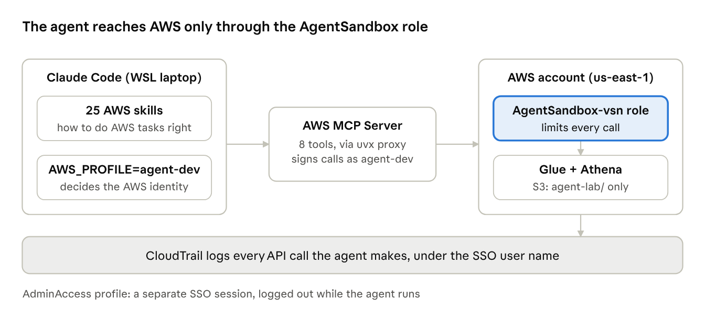

# AWS Agent Toolkit + Claude Code: a least-privilege demo

With one plain-English prompt, an AI coding agent (Claude Code) turned a CSV in S3 into an Athena table and queried it. It did this in about 3 minutes, using a locked-down IAM Identity Center role.



## What the Agent Toolkit for AWS is

The [Agent Toolkit for AWS](https://aws.amazon.com/about-aws/whats-new/2026/05/agent-toolkit) launched in May 2026. It's free: you pay only for the AWS resources your agents use. It gives a coding agent three things:

| Part | Plain meaning | What it does |
| --- | --- | --- |
| AWS MCP Server | The agent's "hands" | Calls AWS APIs and searches current AWS docs. Every call is logged in CloudTrail. |
| Skills (25 by default) | Training manuals | Markdown guides per AWS area. The agent opens only the one it needs. |
| Plugins / setup wizard | The delivery box | Installs the MCP config and skills in one step (`aws configure agent-toolkit`). |

The toolkit holds **no credentials**. What the agent can do depends only on the AWS profile it's started with.

## Security model: two permission sets

| Permission set | Access | Used by |
| --- | --- | --- |
| `AdminAccess` | AdministratorAccess, 1-hour session | You (setup and fixes) |
| `AgentSandbox` | Glue + Athena, one S3 prefix, PassRole for the crawler role only | The agent |

Each profile uses its **own SSO session**, so it has its own token. The admin session stays logged out while the agent runs.

## Setup

### AWS side (console)

1. Create a monthly budget alert (e.g. $5).
2. Enable **IAM Identity Center** (with AWS Organizations) and create an SSO user with MFA.
3. Upload [`data/shipments.csv`](data/shipments.csv) to `s3://<your-bucket>/agent-lab/shipments/`.
4. Create the Glue crawler role `AgentLabGlueCrawlerRole`: the AWS managed `AWSGlueServiceRole` plus [`policies/glue-crawler-role-s3-read.json`](policies/glue-crawler-role-s3-read.json).
5. Create the permission sets:
    - `AdminAccess`: predefined AdministratorAccess
    - `AgentSandbox`: inline [`policies/agent-sandbox-permission-set.json`](policies/agent-sandbox-permission-set.json) plus the AWS managed `AWSMCPSignInOAuthAccessPolicy`
6. Assign both permission sets to your user for the account.

### Laptop side (WSL Ubuntu)

```bash
# Claude Code (needs a paid Claude plan)
curl -fsSL https://claude.ai/install.sh | bash

# AWS CLI v2
curl "https://awscli.amazonaws.com/awscli-exe-linux-x86_64.zip" -o awscliv2.zip
unzip -q awscliv2.zip && sudo ./aws/install

# Two SSO profiles, each with its own session
aws configure sso   # session: admin -> role AdminAccess  -> profile: admin
aws configure sso   # session: lab   -> role AgentSandbox -> profile: agent-dev
# Answer "y" to the Agent Toolkit question: installs skills + MCP server for Claude Code

# uv / uvx (launches the MCP server)
curl -LsSf https://astral.sh/uv/install.sh | sh
```

Check: in Claude Code, `/mcp` should show `aws-mcp: connected`.

## Run the demo

```bash
./scripts/start-agent.sh
```

Then paste the prompt from [`prompts/demo-prompt.txt`](prompts/demo-prompt.txt).

### What the agent did

1. Read-only checks: confirmed the CSV and its columns, the crawler role, and that nothing already existed.
2. Created Glue database `agent_lab_db`.
3. Created a crawler using the **existing** role, limited to the `shipments/` prefix.
4. Ran the crawler and polled its status until done. This created table `shipments`.
5. Ran the Athena query.

| Country | Shipments | Total weight (kg) |
| --- | --- | --- |
| USA | 2 | 5,640 |
| UK | 1 | 4,100 |
| India | 2 | 3,320 |
| UAE | 1 | 85 |

Without being asked, it also flagged that `ship_date` was typed as text and that the CSV had Windows (CRLF) line endings.

## Lessons

- **The IAM role is the real guardrail.** Some MCP calls ran without an approval prompt, even in manual mode.
- **The Glue crawler runs under its own role.** Give the agent `iam:PassRole` on that one role only.
- **Athena writes results with the caller's permissions.** Grant the results bucket, or queries fail.
- **Keep crawler targets clean.** Put data in its own prefix, separate from Athena output.
- **Install `uv`**, or `/mcp` fails with `Executable not found: uvx`.
- **Start Claude Code in a dedicated folder**, never your home folder.
- **Audit in CloudTrail** by filtering on the SSO user name.
- **Supply-chain trust:** `curl | sh` installers and `@latest` packages run code you haven't read. Pin versions for team use.

## Clean up

```bash
aws glue delete-crawler --name agent-lab-shipments-crawler --profile admin
aws glue delete-database --name agent_lab_db --profile admin
```

## References

- [Announcing Agent Toolkit for AWS](https://aws.amazon.com/about-aws/whats-new/2026/05/agent-toolkit)
- [Agent Toolkit plugins](https://docs.aws.amazon.com/agent-toolkit/latest/userguide/plugins.html)
- [AWS CLI support for the Agent Toolkit](https://aws.amazon.com/about-aws/whats-new/2026/06/aws-cli-agent-toolkit)
